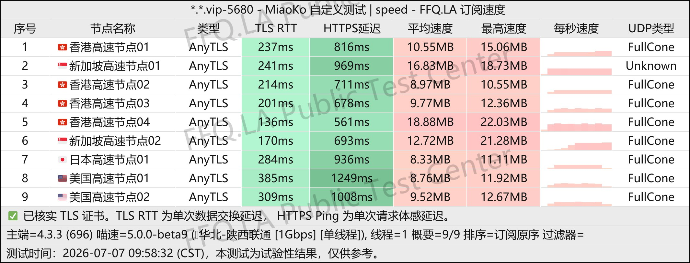
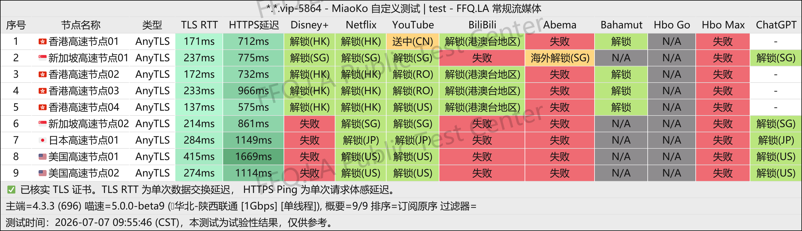
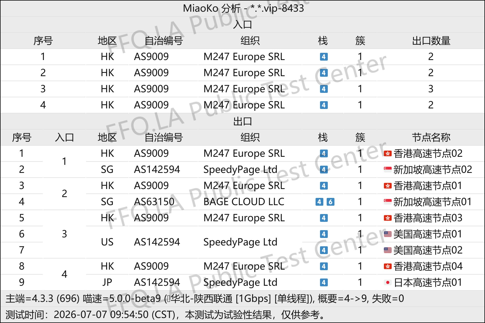

🇨🇳 [中文](README.md) | 🇺🇸 English | 🇷🇺 [Русский](README_RU.md) | 🇮🇷 [فارسی](README_FA.md)

# SuLink VPN Official Website (Updated November 12, 2026)

SuLink VPN Official Website<br>
Official Website: [www.sulink.vip](https://to.iix.im/su01)<br>

⚠️ **This VPN provider has previously become unreachable!** For a similarly priced alternative, you can also check out NiceCloud VPN: [Review](https://github.com/jdnei/nicecloud)<br>

2026 Best VPN Recommendations and Proxy Node Sharing: [https://github.com/jdnei/JiChangTuiJian](https://github.com/jdnei/JiChangTuiJian)<br>

## Telegram VPN Community #AD

[VPN Giveaway Group](https://331024.de/archives/choujiang) | [VPN Chat Group](https://331024.de/archives/choujiang) | [VPN Trial Group](https://331024.de/archives/choujiang)<br>

[https://331024.de/archives/choujiang](https://331024.de/archives/choujiang)

## Invitation Code

`Register with this invitation code to receive a 10 GB trial.`

```bash
fesHf3hr
```

## Introduction

SuLink VPN provides low-latency, high-bandwidth international internet access through its globally optimized dedicated network infrastructure.

The service aims to address restrictions on cross-border internet connectivity and supports a wide range of mainstream proxy protocols. It is designed for users seeking a fast and reliable international network connection.

## Advantages

**High Network Performance:** SuLink uses enterprise-grade dedicated lines and multiple transit points to maintain fast and stable connections across complex international network environments.<br>

**Broad Compatibility:** Supports a wide variety of mainstream proxy clients, with a straightforward and convenient configuration process.<br>

**Transparent and Stable Service:** Features a comprehensive operations and monitoring system designed to maintain reliable node performance and minimize disconnections and network fluctuations.<br>

## Subscription Plans

| Plan | Price | Details |
|---|---|---|
| Monthly 100 GB | ¥9.90/month | 100 GB of traffic per month; nodes in multiple regions worldwide; 1× traffic multiplier; AnyTLS protocol; **BT traffic strictly prohibited** |
| Monthly 300 GB | ¥18.00/month | 300 GB of traffic per month; nodes in multiple regions worldwide; 1× traffic multiplier; AnyTLS protocol; **BT traffic strictly prohibited** |
| Quarterly 100 GB | ¥28.00/quarter | 100 GB of traffic per quarter; nodes in multiple regions worldwide; 1× traffic multiplier; AnyTLS protocol; **BT traffic strictly prohibited** |
| Quarterly 300 GB | ¥52.00/quarter | 300 GB of traffic per quarter; nodes in multiple regions worldwide; 1× traffic multiplier; AnyTLS protocol; **BT traffic strictly prohibited** |
| Annual 100 GB | ¥58.00/year | 100 GB of traffic per year; nodes in multiple regions worldwide; 1× traffic multiplier; AnyTLS protocol; **BT traffic strictly prohibited** |
| Annual 300 GB | ¥209.00/year | 300 GB of traffic per year; nodes in multiple regions worldwide; 1× traffic multiplier; AnyTLS protocol; **BT traffic strictly prohibited** |

## 📊 Performance Tests and Analysis

#### 1. Evening Peak-Hour Speed Test



#### 2. Streaming Platform Unblocking Report



#### 3. Entry and Exit Node Analysis


