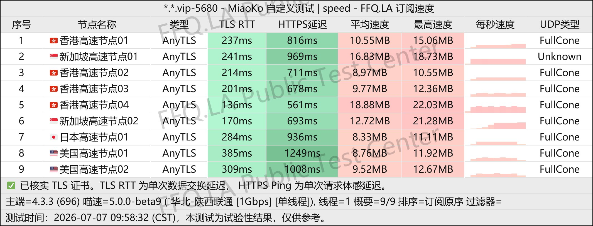
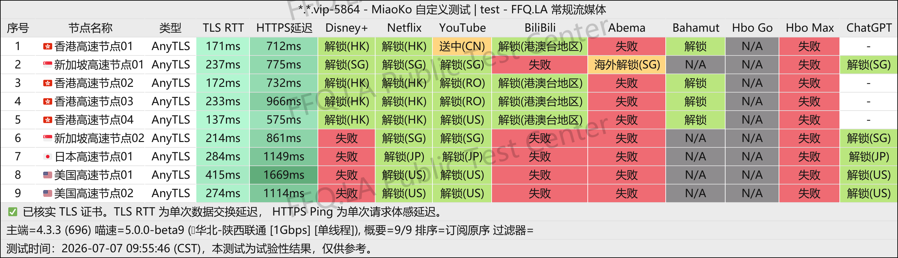
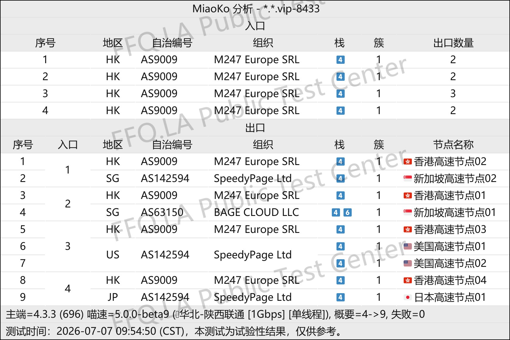

 🇨🇳 [中文](README.md) | 🇺🇸 [English](README_EN.md) | 🇷🇺 [Русский](README_RU.md) | 🇮🇷 فارسی

# وب‌سایت رسمی فیلترشکن SuLink (به‌روزرسانی 14 نوامبر 2026)
وب‌سایت رسمی فیلترشکن SuLink<br>
آدرس رسمی: [www.sulink.vip](https://to.iix.im/su01)<br>

⚠️ **این سرویس VPN در گذشته سابقه قطع ارتباط و از دسترس خارج شدن داشته است!** برای گزینه‌ای با قیمت مشابه، می‌توانید NiceCloud را نیز بررسی کنید: [بررسی و معرفی](https://github.com/jdnei/nicecloud)<br>

معرفی بهترین سرویس‌های VPN و اشتراک‌گذاری سرورهای پروکسی در سال ۲۰۲۶: [https://github.com/jdnei/JiChangTuiJian](https://github.com/jdnei/JiChangTuiJian)<br>

## انجمن تلگرامی VPN #AD

[گروه قرعه‌کشی VPN](https://331024.de/archives/choujiang) | [گروه گفت‌وگوی VPN](https://331024.de/archives/choujiang) | [گروه تست VPN](https://331024.de/archives/choujiang)<br>

[https://331024.de/archives/choujiang](https://331024.de/archives/choujiang)

## کد دعوت

`با ثبت‌نام از طریق این کد دعوت، ۱۰ گیگابایت ترافیک آزمایشی دریافت می‌کنید.`

```bash
fesHf3hr
```

## معرفی

SuLink یک سرویس VPN است که از طریق شبکه جهانی خطوط اختصاصی بهینه‌شده، دسترسی به اینترنت بین‌المللی را با تأخیر کم و پهنای باند بالا فراهم می‌کند.

هدف این سرویس، کاهش مشکلات و محدودیت‌های دسترسی به اینترنت بین‌المللی است. SuLink از انواع پروتکل‌های رایج پروکسی پشتیبانی می‌کند و برای کاربرانی طراحی شده است که به دنبال اتصال سریع و قابل‌اعتماد هستند.

## مزایا

**عملکرد مناسب شبکه:** استفاده از خطوط اختصاصی در سطح سازمانی و چندین نقطه انتقال برای حفظ سرعت و پایداری اتصال، حتی در شرایط پیچیده شبکه‌های بین‌المللی.<br>

**سازگاری گسترده:** پشتیبانی از انواع کلاینت‌های رایج پروکسی با فرایند پیکربندی ساده و سریع.<br>

**خدمات شفاف و پایدار:** برخورداری از سیستم جامع مدیریت، نگهداری و پایش شبکه با هدف حفظ عملکرد پایدار سرورها و کاهش احتمال قطع اتصال و نوسانات شبکه.<br>

## طرح‌های اشتراک

| طرح | قیمت | جزئیات |
|---|---|---|
| ماهانه 100 گیگابایت | ¥9.90 در ماه | ۱۰۰ گیگابایت ترافیک در هر ماه؛ سرورهای متعدد در مناطق مختلف جهان؛ ضریب مصرف ترافیک ۱ برابر؛ پروتکل AnyTLS؛ **استفاده از BT اکیداً ممنوع است** |
| ماهانه 300 گیگابایت | ¥18.00 در ماه | ۳۰۰ گیگابایت ترافیک در هر ماه؛ سرورهای متعدد در مناطق مختلف جهان؛ ضریب مصرف ترافیک ۱ برابر؛ پروتکل AnyTLS؛ **استفاده از BT اکیداً ممنوع است** |
| سه‌ماهه 100 گیگابایت | ¥28.00 در هر سه ماه | ۱۰۰ گیگابایت ترافیک در هر سه ماه؛ سرورهای متعدد در مناطق مختلف جهان؛ ضریب مصرف ترافیک ۱ برابر؛ پروتکل AnyTLS؛ **استفاده از BT اکیداً ممنوع است** |
| سه‌ماهه 300 گیگابایت | ¥52.00 در هر سه ماه | ۳۰۰ گیگابایت ترافیک در هر سه ماه؛ سرورهای متعدد در مناطق مختلف جهان؛ ضریب مصرف ترافیک ۱ برابر؛ پروتکل AnyTLS؛ **استفاده از BT اکیداً ممنوع است** |
| سالانه 100 گیگابایت | ¥58.00 در سال | ۱۰۰ گیگابایت ترافیک در هر سال؛ سرورهای متعدد در مناطق مختلف جهان؛ ضریب مصرف ترافیک ۱ برابر؛ پروتکل AnyTLS؛ **استفاده از BT اکیداً ممنوع است** |
| سالانه 300 گیگابایت | ¥209.00 در سال | ۳۰۰ گیگابایت ترافیک در هر سال؛ سرورهای متعدد در مناطق مختلف جهان؛ ضریب مصرف ترافیک ۱ برابر؛ پروتکل AnyTLS؛ **استفاده از BT اکیداً ممنوع است** |

## 📊 آزمایش عملکرد و تحلیل

#### ۱. آزمایش سرعت در ساعات اوج مصرف شبانه



#### ۲. گزارش رفع محدودیت سرویس‌های پخش آنلاین



#### ۳. تحلیل سرورهای ورودی و خروجی


