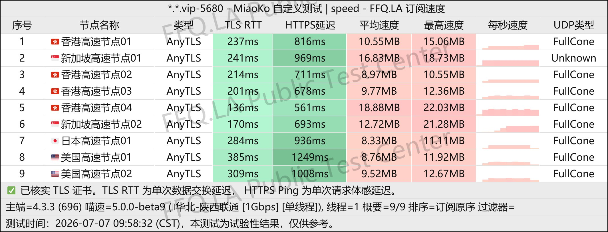
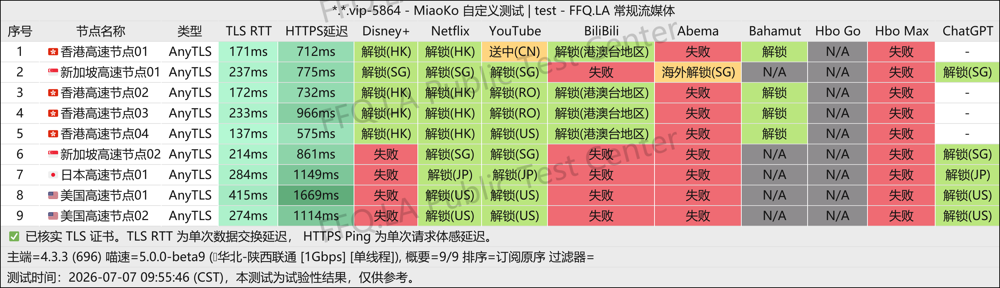
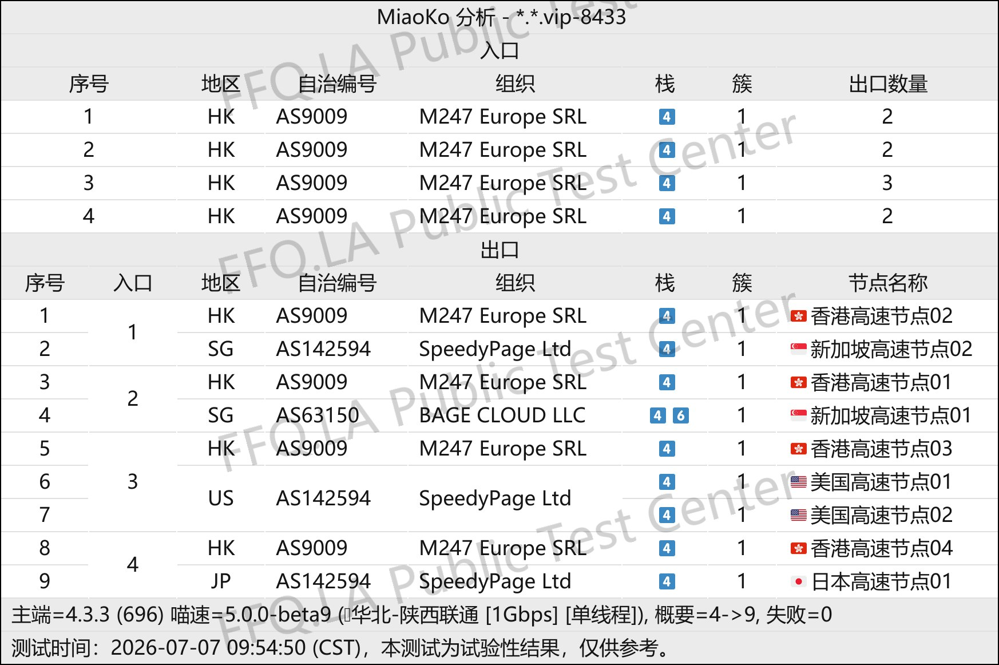

🇨🇳 [中文](README.md) | 🇺🇸 [English](README_EN.md) | 🇷🇺 Русский | 🇮🇷 [فارسی](README_FA.md)

# Официальный сайт SuLink VPN (обновлено 7 ноября 2026)

Официальный сайт SuLink VPN<br>
Официальный адрес: [www.sulink.vip](https://to.iix.im/su01)<br>

⚠️ **В прошлом этот VPN-сервис уже пропадал из доступа!** В качестве альтернативы с сопоставимыми ценами можно рассмотреть NiceCloud VPN: [Обзор](https://github.com/jdnei/nicecloud)<br>

Лучшие VPN-сервисы и прокси-серверы 2026 года: [https://github.com/jdnei/JiChangTuiJian](https://github.com/jdnei/JiChangTuiJian)<br>

## Telegram-сообщество VPN #AD

[Группа розыгрышей VPN](https://331024.de/archives/choujiang) | [Чат VPN](https://331024.de/archives/choujiang) | [Группа тестирования VPN](https://331024.de/archives/choujiang)<br>

[https://331024.de/archives/choujiang](https://331024.de/archives/choujiang)

## Пригласительный код

`При регистрации с этим пригласительным кодом предоставляется 10 ГБ пробного трафика.`

```bash
fesHf3hr
```

## Описание

SuLink VPN предоставляет высокоскоростной международный доступ к интернету с низкой задержкой и высокой пропускной способностью благодаря глобальной сети оптимизированных выделенных каналов.

Сервис предназначен для преодоления ограничений международного интернет-доступа и поддерживает широкий спектр популярных прокси-протоколов.

SuLink ориентирован на пользователей, которым требуется быстрое и надёжное подключение к зарубежным интернет-ресурсам.

## Преимущества

**Высокая производительность сети:** Использование выделенных каналов корпоративного уровня и нескольких транзитных точек позволяет поддерживать высокую скорость и стабильность соединения даже в сложных международных сетевых условиях.<br>

**Широкая совместимость:** Поддержка различных популярных прокси-клиентов с простой и быстрой настройкой подключения.<br>

**Прозрачность и стабильность обслуживания:** Комплексная система эксплуатации и мониторинга сети предназначена для обеспечения надёжной работы серверов, снижения риска разрывов соединения и уменьшения сетевых колебаний.<br>

## Тарифные планы

| Тариф | Цена | Подробности |
|---|---|---|
| Месячный 100 ГБ | ¥9.90/мес. | 100 ГБ трафика в месяц; серверы в различных регионах мира; коэффициент расхода трафика 1×; протокол AnyTLS; **использование BT строго запрещено** |
| Месячный 300 ГБ | ¥18.00/мес. | 300 ГБ трафика в месяц; серверы в различных регионах мира; коэффициент расхода трафика 1×; протокол AnyTLS; **использование BT строго запрещено** |
| Квартальный 100 ГБ | ¥28.00/квартал | 100 ГБ трафика за квартал; серверы в различных регионах мира; коэффициент расхода трафика 1×; протокол AnyTLS; **использование BT строго запрещено** |
| Квартальный 300 ГБ | ¥52.00/квартал | 300 ГБ трафика за квартал; серверы в различных регионах мира; коэффициент расхода трафика 1×; протокол AnyTLS; **использование BT строго запрещено** |
| Годовой 100 ГБ | ¥58.00/год | 100 ГБ трафика в год; серверы в различных регионах мира; коэффициент расхода трафика 1×; протокол AnyTLS; **использование BT строго запрещено** |
| Годовой 300 ГБ | ¥209.00/год | 300 ГБ трафика в год; серверы в различных регионах мира; коэффициент расхода трафика 1×; протокол AnyTLS; **использование BT строго запрещено** |

## 📊 Тестирование производительности и анализ

#### 1. Тест скорости в вечерние часы пик



#### 2. Отчёт о разблокировке стриминговых сервисов



#### 3. Анализ входных и выходных узлов


